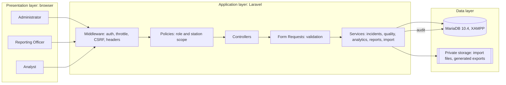
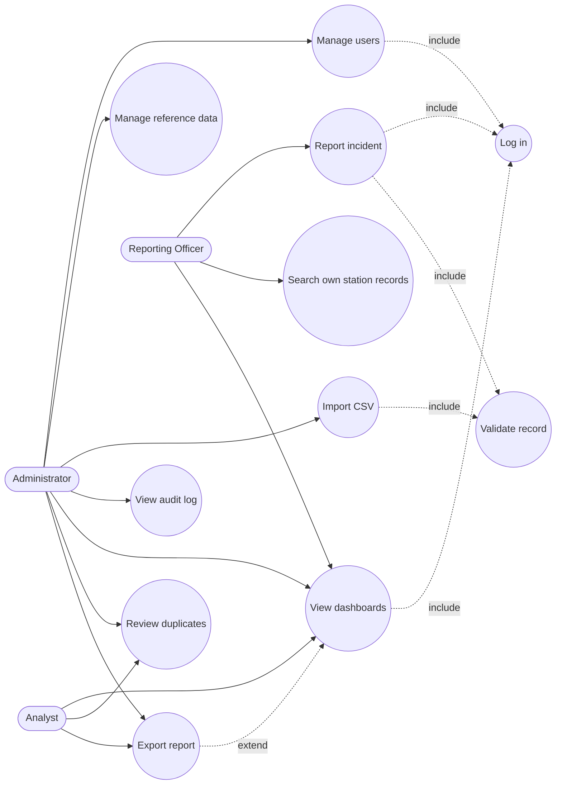
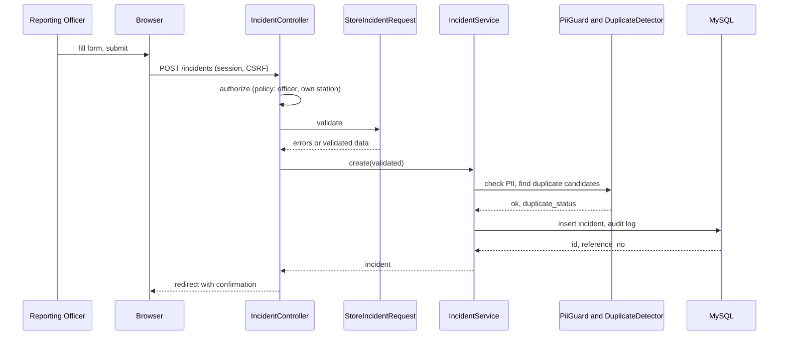
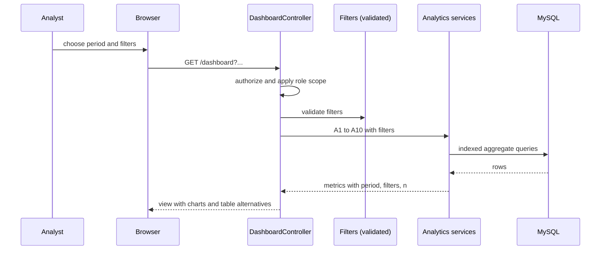
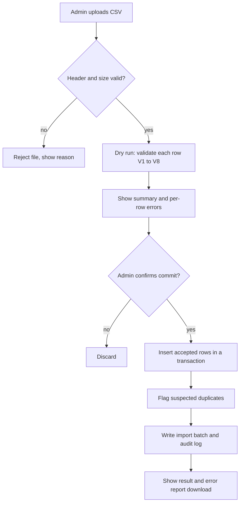

# 03. Architecture and data model

Design source for Chapter 4 and for the code. Names below are proposals; the migrations become the source of truth once they exist (project rules).

## 1. Layers (proposal 3.7)



## 2. Code layout (Laravel 12, target)

```
app/
  Http/Controllers/        thin controllers
  Http/Requests/           Form Requests (validation)
  Http/Middleware/         security headers, station scope
  Models/                  User, Incident, Category, SubCounty, Ward, Station, AuditLog, ImportBatch
  Policies/                IncidentPolicy, UserPolicy, ...
  Services/                IncidentService, DuplicateDetector, PiiGuard, ImportService,
                           Analytics/ (one class per metric group), ReportService
  Support/                 value objects (Period, Filters)
config/analytics.php       hotspot and duplicate parameters, read from env
database/migrations/       schema
database/seeders/          reference data, admin (from env), sample data (deterministic)
resources/views/           Blade views and chart partials
tests/                     Unit, Feature, Security, Performance, oracle fixtures
```

## 3. Database schema (as built, Phase 2)

Source of truth: `database/migrations/2026_09_25_*.php`. Diagram: `docs/diagrams/erd.md`.

| Table | Key columns | Integrity rules |
|---|---|---|
| `users` | id, name, email (unique), password (bcrypt), role (`admin`, `officer`, `analyst`, default `officer`), station_id (nullable), is_active, failed_attempts, locked_until, must_change_password (default true), last_login_at | No self-registration; never deleted, only deactivated (D-33); role and station not mass-assignable |
| `sub_counties` | id, name (unique) | Reference, 17 rows (D-28) |
| `wards` | id, sub_county_id, name; unique (sub_county_id, name); unique (id, sub_county_id) | Reference, 85 rows; the second key is the target of the incidents composite key |
| `stations` | id, sub_county_id, name (unique), is_active | Synthetic sample stations |
| `crime_categories` | id, name (unique), is_active | Theft, Robbery, Burglary, Assault, Other |
| `incidents` | id, reference_no (unique), category_id, occurred_at, reported_at, sub_county_id, ward_id, station_id, location_description (150), description (text, 1,000 enforced by validation), status, closed_at, duplicate_status, duplicate_of_id, is_synthetic (default true), import_batch_id, created_by, updated_by, timestamps, deleted_at | Composite key (ward_id, sub_county_id) to wards (V4 in the database); CHECK on status, duplicate_status, closed_at iff closed, reported_at >= occurred_at; no coordinate column |
| `import_batches` | id, user_id, file_name, stored_path, status (`dry_run`, `committed`, `discarded`), rows_total, rows_accepted, rows_rejected, rows_flagged_duplicate, error_report (json) | Error report holds row, column and rule only, never cell values (D-34) |
| `audit_logs` | id, user_id, action, entity_type, entity_id, meta (json), ip_address, created_at | Append-only: model guard plus BEFORE UPDATE and BEFORE DELETE triggers (D-32) |
| `report_exports` | id, user_id, type (`csv`, `pdf`), filters (json), row_count, created_at | Export history |

Indexes (named explicitly): `incidents_occurred_at_index`, `incidents_category_occurred_index`, `incidents_ward_occurred_index`, `incidents_sub_county_occurred_index`, `incidents_station_occurred_index`, `incidents_status_index`, `incidents_duplicate_status_index`, `incidents_import_batch_id_index`, `audit_logs_created_at_index`, `audit_logs_user_created_index`, `audit_logs_action_index`, `import_batches_created_at_index`, `report_exports_created_at_index`, `users_role_index`. Confirm with `EXPLAIN` on the analytics and duplicate queries and record the plans in the test log (a `(ward_id, category_id, occurred_at)` index is considered in Phase 4 only if EXPLAIN shows the need).

## 4. Use cases (Chapter 4 draft)



Draw the final versions as UML use case diagrams in Visual Paradigm with a system boundary, per the faculty guide.

## 5. Key sequences (Chapter 4 drafts)

Report an incident:



Analytics request:



## 6. Activity: bulk import (Chapter 4 draft)



## 7. Conceptual framework redraw (Figure 2.1 replacement)

Keep the input, process, output, outcome structure but add what the marker asked for and remove all GIS elements:

| Element | Content |
|---|---|
| Actors | Administrator, Reporting Officer, Analyst (with the access each has) |
| Inputs | Incident report (category, date and time, sub-county, ward, description); reference data; user accounts; sample or historical data via CSV |
| Process | Authenticate and authorise; validate; PII guard; duplicate detection; store; aggregate and analyse (A1 to A10); render dashboards and reports |
| Storage boundary | Central MySQL database; private file storage for imports and exports |
| Outputs | Dashboards, charts, area rankings and hotspot flags, PDF and CSV reports, audit log |
| Outcomes | Better record quality, faster insight into trends and peak times, better resource allocation, evidence-based decisions |
| Feedback loop | Data-quality summary and analyst findings improve reporting practice and validation rules |
| Removed | GPS coordinates, hotspot boundaries, crime maps, spatial analysis |

## 8. Security architecture

| Concern | Design |
|---|---|
| Authentication | Session auth with Laravel Fortify and own Bootstrap views (D-19), no public registration, preflight middleware refuses every request when a runtime secret is invalid (D-23), lockout counter on the user record, login throttling by email and IP |
| Authorization | Policies per model plus route middleware; station scope applied in a query scope so a missed check cannot leak rows |
| Secrets | Environment only; preflight refuses to boot on missing or short values |
| Input | Form Requests; query builder bindings; Blade escaping; CSV import parsed with strict header check and row limits |
| Transport and headers | HTTPS in any shared deployment; CSP and other headers by middleware, tested |
| Audit | Append-only table; no sensitive field content |
| Files | Uploads stored privately, size and type checked, deleted after processing |

## 9. Performance and caching

Aggregates are computed in SQL with the indexes above. If dashboards miss the target, cache filter-keyed aggregate results for a short time; the invalidation rule (any incident create, update, delete, duplicate resolution, or import clears the affected keys) is written first and covered by a test before the cache ships. Record `EXPLAIN` plans and timings in `logs/TEST_LOG.md`.

## 10. Wireframes and interface plan

Screens: login; dashboard; incident list with filters; incident create and edit; incident detail; duplicate review queue; import (upload, dry-run result, commit); reports and export; data-quality summary; admin (users, reference data); audit log. Produce low-fidelity wireframes in Phase 2 and show them to the supervisor before building views (Chapter 4 wireframes, marker "interface design").
